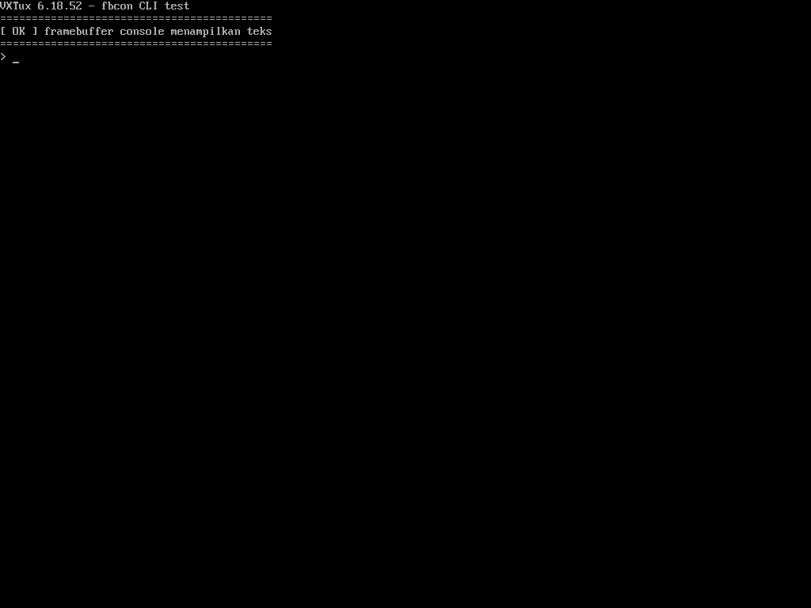

# Validasi Boot QEMU (qemu-ums512-t1030) — HASIL LULUS

**Run hijau:** https://github.com/gryzzlaycutzy121/advan-vxtux-6.18.52/actions/runs/40100295454
(QEMU Boot Test #8, `test1`, 20m40s, 2026-10-24 — satu warning kosmetik cpio, lihat §4)

**Run fbcon hijau:** https://github.com/gryzzlaycutzy121/advan-vxtux-6.18.52/actions/runs/40105064859
(2026-10-24 — gerbang `marker: stock=1 custom=1 fb=1 px=1`, lihat §5)

**Gate:** `marker: stock=1 custom=1` → `BOOT OK — DTB kustom tembus userspace tanpa panic`.

Bukti dari artefak `qemu-serial` (diunduh ke `ci_qemu/run8/`):

| Boot | Serial | exit | Marker | Panic |
|---|---|---|---|---|
| DTB stok `-M virt` | 15 271 B | 0 | ✓ | tidak ada |
| DTB kustom `qemu-ums512-t1030` | 15 264 B | 0 | ✓ | tidak ada |

Kustom: kernel tembus ke userspace dalam ~4 detik
(`Run /init as init process` di 3,92 s), init C menulis
`=== VXTUX-QEMU-BOOT-OK ===` ke console+kmsg (baris 207–212 log serial),
lalu `reboot(RB_POWER_OFF)` → QEMU exit 0.

## 1. Tiga akar masalah "boot kustom 0 byte" (run 40094005980)

Bisect dua boot dalam satu run membuktikan masalah di DTB kustom, bukan di
Image. Akar penyebab dibuktikan dari kode QEMU 6.2 `hw/arm/virt.c` +
`include/hw/arm/virt.h`:

1. **GICR salah peta.** DTB lama memetakan redistributor di `0x08010000`
   (area `VIRT_GIC_CPU`, tidak dipetakan QEMU pada mode gicv3). Alamat benar
   dari `base_memmap`: `GICR @0x080A0000`, ukuran `0xF60000` (123 redist ×
   64 kB, berakhir tepat di UART `0x09000000`). Probe GIC menggantung di
   redistributor tak terpetakan sebelum konsol hidup.
2. **PSCI `method = "smc"` → `"hvc"`.** `virt.c` menentukan conduit dari
   properti `virtualization` yang default OFF → selalu `QEMU_PSCI_CONDUIT_HVC`
   (rumus: `secure && fw ? DISABLED : virtualization ? SMC : HVC`). Instruksi
   SMC dari EL1 tanpa EL2 = undefined instruction trap dini.
3. **Node PCIe + ITS tidak ada.** `-device virtio-serial-pci` tak pernah
   terenumerasi tanpa `pcie@10000000` (ECAM `@0x3F000000`) di DT → `hvc0`
   mustahil ada. Ditambahkan `its@8080000` (arm,gic-v3-its) sebagai
   `msi-parent`; QEMU dijalankan dengan `highmem=off` sehingga rentang PCIe
   cukup PIO + MMIO32 (identik keluaran QEMU). `CONFIG_PCI_HOST_GENERIC=y`
   sudah `=y` dari basis enhanced_config.

## 2. Initramfs: init C statis, tanpa busybox

Dua kegagalan busybox tercatat sebelumnya:

- run 40090028825: `/bin/busybox` milik runner x86-64 → `ENOEXEC` (exitcode 5);
- run 40094005980: `busybox-static:arm64` hasil unduhan ports → undefined
  instruction di tamu (`el0_undef`, exitcode `0x4`) pada `-cpu cortex-a72`.

Sekarang: `aarch64-linux-gnu-gcc -static -O2 -march=armv8-a -mabi=lp64`,
mount proc/sys/dev, marker ke console **dan** kmsg, `RB_POWER_OFF`.
Guard CI memverifikasi `file` = `ELF ... ARM aarch64 ... statically linked`.

## 3. Gerbang workflow (urutan, gagal cepat)

Config guard → **Build DTB (~3 menit, gagal cepat)** → Build Image (~19
menit) → Initramfs → Boot bisect 2×240 s → upload artefak serial.

## 4. Catatan warning tunggal (kosmetik)

`grep -qx './init'` pada output `cpio -t` gagal (daftar format berbeda
antarversi cpio — blok ini belum pernah teruji di run manapun sebelumnya).
Diturunkan jadi `::warning::` non-fatal + dump isi arsip; bukti arsip benar:
1264 blok × 512 B = 647 KB ≈ ukuran binary init, dan boot gate tetap
mendeteksi init hilang lewat panic "No working init found".

## 5. fbcon & DRM/KMS: PRINT CLI — TERBUKTI (run 40105064859)

Jawaban atas "apakah fbcon dan DRM/KMS sudah bisa print CLI?": **ya,
setelah rantai berikut dinyalakan** — sebelumnya mustahil karena tiga
simpul mati: `CONFIG_FB=n` (enhanced_config), `FRAMEBUFFER_CONSOLE` tak
terdefinisi (`FB_CORE` tak ter-select), dan QEMU tanpa driver GPU
(`DRM_VIRTIO_GPU`/`BOCHS` not set).

Rantai yang dinyalakan lewat fragmen `vxtux_618_qemu.defconfig` (lolos
olddefconfig — guard CI memeriksanya):

```
DRM_VIRTIO_GPU=y → select DRM_CLIENT_SELECTION
                 → DRM_FBDEV_EMULATION=y → select FB_CORE (oleh DRM)
                 → FRAMEBUFFER_CONSOLE=y (+ VT_CONSOLE untuk printk boot)
```

Boot ketiga ditambahkan ke workflow: `-device virtio-gpu-pci`
(dienumerasi via node PCIe + ITS di DTB kustom), VNC headless sebagai
permukaan display, monitor HMP TCP → `screendump` → `fbcon.ppm` →
`fbcon.png`. Init C menulis banner CLI ke `/dev/tty1` (176 byte) dan
menunda poweroff 8 detik supaya capture tidak kalah cepat.

**Bukti (artefak run, tersimpan di [evidence-20261024/fbcon.png](evidence-20261024/fbcon.png)):**

| Bukti | Nilai |
|---|---|
| Probe DRM | `[drm] Initialized virtio_gpu 0.1.0 for 0000:00:03.0 on minor 0` |
| fbcon menempel | `Console: switching to colour frame buffer device 128x48` |
| Framebuffer | `fb0: virtio_gpudrmfb frame buffer device` |
| Tulisan init ke VT | `=== tty1: 176 byte CLI tertulis ===` |
| Gerbang piksel | `fbcon framebuffer: 1024x768, piksel tak-hitam=2842` → `FBCON RENDER OK` |
| Gate akhir | `marker: stock=1 custom=1 fb=1 px=1` → run **success** |



Tampilan: banner `VXTux 6.18.52 - fbcon CLI test` + `[ OK ] framebuffer
console menampilkan teks` + prompt `>` dengan kursor — teks dirender
DRM/fbcon ke framebuffer 1024×768, bukan lewat serial (huruf pertama
terpotong tipis di margin kiri — kosmetik, kemungkinan pergeseran sel
fbcon setelah clear-screen). Konsol `hvc0` tetap menerima printk boot
gaya Arch (VT_CONSOLE=y) di log serial.

Status di **perangkat UMS512 asli**: config device masih `CONFIG_FB=n`
+ driver `DRM_SPRD` bermasalah (layar garis hijau) — fbcon device akan
menyala setelah config + perbaikan panel DRM dilakukan; QEMU di atas
membuktikan jalur fbcon/kernel-nya sendiri sehat.

## 6. Batas validasi (jujur)

- QEMU `-M virt` + TCG **bukan** hardware UMS512: alamat periferal QEMU
  berbeda total dari DT perangkat; yang divalidasi adalah perilaku kernel
  (probe GIC/PCIe/virtio, jalur konsol, init, panic-free) di lingkungan
  yang deterministik.
- Driver vendor (sprd-cpufreq-v2, mmc_swcq, sprd_iq, dll.) **tidak**
  dieksekusi di QEMU (perangkat tak ada di DTB QEMU) — pengujian perangkat
  nyata tetap lewat boot `ums512-1h10-vxtux.dtb` di hardware.
- `interrupt-map` INTx PCIe sengaja tidak ditulis; semua perangkat uji
  memakai MSI via ITS.
